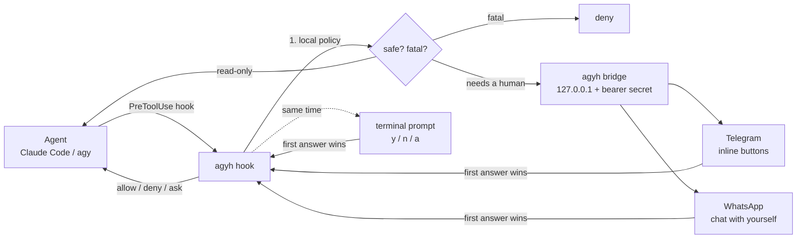

# agyh

[](https://github.com/EliasOlie/agyh/actions/workflows/ci.yml)
[](go.mod)
[](LICENSE)

**Every conversation with your coding agents, in one place: search it, organize it into projects, resume it, and approve what the agent does from your phone.**

`agyh` reads the local history of **Antigravity (`agy`)**, **Claude Code** and **Codex**, indexes it into a single full-text search, and pairs with **Telegram** or **WhatsApp** so a long-running agent can ask *you* before it runs `git push`, even when you are away from the keyboard.

One static Go binary. No server, no account, no telemetry. Your agents' files are only ever read.

```
agyh  all agents · 55 sessions
🔎 rotação credenciais

▸ agy    Credential rotation for the Postgres control plane               3d
         ~/work/pg-cp · #security · …implement [rotação] de [credenciais] with zero downtime…
  claude Refresh-token reuse detection                                    28d
         ~/work/auth · …a token_version bump makes the [rotação] revoke every session…

type to search · ↑/↓ · enter open · ctrl+o resume · ctrl+p project · tab agent · esc quit
```

## Why

Agent CLIs keep history per tool and per folder. After a few weeks you have hundreds of sessions and no way to find "the one where we fixed the Pix webhook", group the five sessions that belong to one feature, or reopen it in the right directory. And when an agent works for 40 minutes, the moment it needs permission is usually the moment you stepped away.

## Features

| | |
|---|---|
| **One index, every agent** | Antigravity, Claude Code and Codex sessions in one list, newest first. |
| **Instant full-text search** | SQLite FTS5 over every message: accent- and case-insensitive (`rotacao` finds *rotação*), prefix matching, highlighted snippets. Ranked by BM25 with **recency tiers** (7d ×4 › 15d ×3 › 30d ×2 › 90d ×1.5), so this week's work comes first. |
| **Incremental indexing** | Only files whose mtime changed are re-parsed: 55 sessions index in ~0.8 s, a re-sync takes ~60 ms. |
| **Projects** | Save sessions from any agent into named projects, with notes. Filter the browser, the CLI and the chat by project. |
| **Resume anywhere** | `agyh resume <id>` reopens the session in its agent **and** its original workspace. |
| **Interactive TUI** | Live search as you type, read whole transcripts, resume, save to project, copy the id (OSC 52). |
| **Encrypted Cloud Vault** | Synchronize sessions & projects across multiple machines via S3-compatible storage (VPSQL S3, MinIO, R2, AWS). Zero-knowledge client-side encryption (AES-256-GCM + PBKDF2). Instant disaster recovery (`agyh sync restore`). |
| **Remote approvals** | Agent hooks send risky commands to Telegram (inline buttons) and/or WhatsApp; the first answer wins, phone or terminal. |
| **Autonomous mode** | One tap allows the rest of a session, while fatal commands stay blocked. |
| **Drive agents from chat** | `/chats`, `/search`, `/show`, `/save`, `/projects`, `/new` (start a headless session in a whitelisted workspace). |
| **WhatsApp onboarding in the terminal** | `agyh connect whatsapp` prints the pairing QR code right in your terminal. |
| **Scriptable** | Every list command has `--json`. |

## Install

Requires Go 1.26+ (older Go downloads the right toolchain automatically).

```bash
go install github.com/EliasOlie/agyh/cmd/agyh@latest
agyh --version
```

### `agyh: command not found`?

`go install` puts the binary in Go's bin directory: `$(go env GOBIN)`, or `$(go env GOPATH)/bin` (usually `~/go/bin`). Many setups don't have that directory on `PATH`. Pick one fix:

**A. Add Go's bin directory to your PATH** (once; works for every `go install`):

```bash
# bash
echo 'export PATH="$PATH:$(go env GOPATH)/bin"' >> ~/.bashrc && source ~/.bashrc
# zsh
echo 'export PATH="$PATH:$(go env GOPATH)/bin"' >> ~/.zshrc && source ~/.zshrc
# fish
fish_add_path (go env GOPATH)/bin
```

On Windows (PowerShell): `[Environment]::SetEnvironmentVariable("Path", $env:Path + ";$(go env GOPATH)\bin", "User")`, then open a new terminal.

**B. Or install straight into a directory that is already on your PATH:**

```bash
GOBIN="$HOME/.local/bin" go install github.com/EliasOlie/agyh/cmd/agyh@latest
```

If the shell still says *not found* right after installing, run `hash -r` (bash) or `rehash` (zsh), or open a new terminal.

### From source

```bash
git clone https://github.com/EliasOlie/agyh && cd agyh
go build -o agyh ./cmd/agyh   # then move it anywhere on your PATH
```

Pure Go (SQLite via `modernc.org/sqlite`), so `CGO_ENABLED=0` cross-compiles to Linux, macOS and Windows.

## Use it

```bash
agyh                         # interactive browser
agyh pix webhook             # browser, pre-filled with a search
agyh ls -n 20 --agent claude # list
agyh search rotação token    # full-text search (--json for scripts)
agyh show 2ec95bab --last 4  # read a session
agyh resume 2ec9             # reopen it (any unique id prefix works)
agyh resume --last           # reopen the most recent session

agyh project add pagamentos 2ec9 5e6b --note "Pix refunds"
agyh project ls
agyh -p pagamentos           # browser inside one project
```

| Command | What it does |
|---|---|
| `agyh [words]` | Interactive browser (TUI). `-p <project>` scopes it. |
| `agyh ls` / `agyh search <words>` | List or search. Filters: `--agent`, `--project`, `--workspace`, `--all` (sub-agents), `-n`, `--json`. |
| `agyh show <id>` | Metadata and messages. `--last N`, `--json`. |
| `agyh resume [<id> \| --last]` | Exec the agent in the session's workspace. `--print` shows the command instead. |
| `agyh index [--full]` | Sync the index (normally automatic). |
| `agyh project new\|ls\|add\|rm\|show\|rename\|delete` | Manage projects. |
| `agyh sync [status\|push\|pull\|restore]` | Synchronize or restore sessions with encrypted cloud vault. |
| `agyh connect telegram\|whatsapp` | Pair a chat channel. |
| `agyh bridge` | Run the daemon that connects hooks and chat. |
| `agyh install-hooks claude\|agy` | Print the hook config to paste into your agent. |
| `agyh doctor` | Check agents, index, channels and bridge. |

## Remote control



### 1. Pair a channel

**Telegram** (recommended): create a bot with [@BotFather](https://t.me/BotFather), then:

```bash
agyh connect telegram
# Bot token from @BotFather (input hidden): ********
# ✓ Bot @my_agyh_bot found. Now open https://t.me/my_agyh_bot and send /start…
# ✓ Paired with @you (chat 123456789).
```

The bot answers **only that chat id**: anyone else who finds it gets nothing.

**WhatsApp**: links agyh as a device, like WhatsApp Web, and prints the QR code in the terminal:

```bash
agyh connect whatsapp
# On your phone: WhatsApp → Settings → Linked devices → Link a device, then scan:
# █▀▀▀▀▀█ ▄▀ ▄█▀ █▀▀▀▀▀█
# …
```

You then talk to agyh in the **"Message yourself"** chat; every other chat is ignored. This uses [whatsmeow](https://github.com/tulir/whatsmeow), an *unofficial* client. WhatsApp may restrict accounts that use unofficial clients, so prefer a secondary number or use Telegram.

### 2. Install the hooks

```bash
agyh install-hooks claude   # paste into ~/.claude/settings.json
agyh install-hooks agy      # paste into your Antigravity hooks file
```

For Claude Code this adds a `PreToolUse` hook on `Bash` and a `Stop` hook that sends you the agent's final message when it finishes.

### 3. Run the bridge

```bash
agyh bridge     # or as a systemd --user service, see below
```

### How a decision is made

1. **Local policy, in under a millisecond, without the network.**
   - **Fatal** commands are always denied, even in autonomous mode: `sudo`, `rm -rf /`, `git push --force`, `curl … | sh`, writing to `/dev/sd*`, touching `~/.ssh` keys, and so on.
   - **Read-only** commands are allowed: `ls`, `git status`, `rg`, `go vet`, …
   - A command is only read-only if **every** segment of the pipeline or chain is, and it has no redirection (`>`), command substitution (`$(…)`, backticks) or `find -exec`/`-delete`.
2. **Everything else needs a human.** The hook asks the bridge, which sends the request to every connected channel. For Antigravity it also asks in the terminal, with a single keypress. **The first answer wins**, and every other channel is updated ("✅ Allowed via telegram").
3. **⚡ Allow whole session** switches that session to autonomous mode. It persists across bridge restarts and can be turned off with `/auto off <id>`.
4. **No answer before the timeout** (default 120 s), or no bridge running: Claude Code falls back to its own permission prompt (`ask`). Antigravity, which has no "ask", denies.

Add your own patterns in the config: `"policy": {"safe": ["^make\\s+test(\\s|$)"], "fatal": ["\\bterraform\\s+destroy\\b"]}`.

### Chat commands (Bilingual / PT-BR & EN)

| Command / Comando | What it does / O que faz |
|---|---|
| `/chats [n]` · `/sessoes` | Recent sessions from every agent / Sessões recentes |
| `/search <words>` · `/buscar` | Full-text search / Busca em todo o histórico |
| `/show <id>` · `/ver` | Details and messages / Detalhes e mensagens da conversa |
| `/save <id> <project> [note]` · `/salvar` | Save a session into a project / Salvar sessão no projeto |
| `/projects` · `/projetos` | Browse projects / Listar projetos |
| `/new [agent] [@workspace] <prompt>` · `/novo` | Start a headless session / Iniciar tarefa em background |
| `/ws` | Workspaces `/new` may use |
| `/pending` · `/pendentes` | Pending approvals / Aprovações pendentes |
| `/auto [off <id>]` | Autonomous sessions / Sessões em modo autônomo |
| `/sync` · `/sincronizar` | Synchronize with cloud vault / Sincronizar com vault |
| `/start` · `/ajuda` · `/help` | Interactive onboarding & command guide |
| `s <id>` · `y` · `sim` · `allow` | Allow / Permitir comando |
| `n <id>` · `nao` · `rejeitar` · `deny` | Deny / Rejeitar comando |
| `a <id>` · `auto` · `sempre` | Allow whole session (autonomous mode) ⚡ |

## Cloud Vault & Disaster Recovery

Agent history is normally trapped on a single machine and lost whenever you format, switch laptops or work on a remote server. `agyh` includes a client-side encrypted cloud sync engine that turns your history into a persistent, multi-machine AI memory bank:

- **Zero-knowledge encryption**: Every session transcript and project association is compressed with `gzip` and encrypted client-side with **AES-256-GCM** using a key derived via **PBKDF2** (100,000 rounds of SHA-256). Even if the S3 bucket is public, your conversations remain unreadable without your master passphrase.
- **Self-hosted & S3-compatible**: Works natively with **VPSQL S3**, Cloudflare R2, MinIO, or AWS S3. No SDK dependencies; pure Go implementation over AWS SigV4.
- **Local-first with Archive fallback**: Full-text search and transcript browsing stay local (0 ms latency via SQLite FTS5). If you open a session synced from another machine where local agent files don't exist, `agyh` transparently loads the transcript from its local encrypted archive cache.

```bash
# Check differences between local store and cloud vault
agyh sync status

# Bidirectional sync (uploads local changes, pulls remote sessions)
agyh sync

# Force upload or pull
agyh sync push
agyh sync pull

# Fresh machine or disaster recovery? Reconstruct your entire history from zero:
agyh sync restore
```

## Security model

agyh can approve shell commands, so it is built to fail closed:

- The bridge listens on **loopback only**; it refuses to start on any other address. Every call needs a 256-bit bearer secret, compared in constant time.
- `~/.config/agyh/config.json` and the WhatsApp session store are written with mode `0600`.
- Chat input is never passed to a shell. `/new` runs the configured runner with the prompt as **one argv element**, and only inside workspaces listed in the config.
- Only the paired Telegram chat id, or your own WhatsApp "Message yourself" chat, can send commands or press buttons.
- The bridge re-checks the policy itself, so even a misconfigured hook or autonomous session cannot get a fatal command approved.
- The bot token never appears in errors or logs. Network errors from the Bot API are stripped of the URL.
- Agent data is opened **read-only** (`mode=ro` for SQLite). The only file agyh writes is its own index.

## Configuration

`~/.config/agyh/config.json` (created by `connect`):

```json
{
  "bridge": { "addr": "127.0.0.1:9123", "secret": "generated" },
  "telegram": { "token": "from @BotFather", "chat_id": 123456789 },
  "whatsapp": { "enabled": true, "jid": "5581999999999@s.whatsapp.net" },
  "approval_timeout_sec": 120,
  "runners": { "claude": ["claude", "-p", "{prompt}"] },
  "workspaces": ["/home/you/work/api", "/home/you/work/pdv"],
  "policy": { "safe": [], "fatal": [] },
  "sync": {
    "enabled": true,
    "endpoint": "https://api-vpsql.eliasolie.com.br/s3",
    "bucket": "agyh-vault",
    "region": "us-east-1",
    "access_key": "vpsql_ak_...",
    "secret_key": "vpsql_sk_...",
    "passphrase": "your-master-encryption-key",
    "prefix": "vault"
  }
}
```

| Variable | Default |
|---|---|
| `AGYH_DB` | `$XDG_DATA_HOME/agyh/index.db` (`~/.local/share/agyh/index.db`) |
| `AGYH_CONFIG_DIR` | `$XDG_CONFIG_HOME/agyh` |
| `AGYH_AGY_DIR` | `~/.gemini/antigravity-cli` |
| `AGYH_CLAUDE_DIR` | `$CLAUDE_CONFIG_DIR/projects` or `~/.claude/projects` |
| `AGYH_CODEX_DIR` | `$CODEX_HOME/sessions` or `~/.codex/sessions` |
| `AGYH_SYNC_ENDPOINT` | Custom S3 endpoint URL (e.g. `https://api-vpsql.../s3`) |
| `AGYH_SYNC_BUCKET` | S3 bucket name |
| `AGYH_SYNC_PASSPHRASE` | Passphrase for client-side AES-256-GCM zero-knowledge encryption |

Run the bridge as a user service:

```ini
# ~/.config/systemd/user/agyh-bridge.service
[Unit]
Description=agyh bridge
After=network-online.target

[Service]
ExecStart=%h/go/bin/agyh bridge
Restart=on-failure

[Install]
WantedBy=default.target
```

```bash
systemctl --user enable --now agyh-bridge
```

## Where the data comes from

| Agent | Sessions | Messages |
|---|---|---|
| Antigravity | `conversation_summaries.db` (read-only) | `brain/<id>/.system_generated/logs/transcript.jsonl`; user text from `<USER_REQUEST>` |
| Claude Code | `projects/<encoded-cwd>/<id>.jsonl` | `user` / `assistant` text blocks; tool calls, sidechains, meta and slash-command noise dropped; `custom-title` honored |
| Codex | `sessions/YYYY/MM/DD/rollout-*.jsonl` | `response_item` messages; environment and instruction preambles dropped |

Adding an agent means implementing one interface (`internal/source`): `Refs` (list cheaply), `Load` (parse one session), `Resume` (argv to reopen).

## Design notes

- **Read cheaply, parse lazily.** `Refs` only stats files. The indexer compares mtimes with the index and parses the changed sessions in a bounded worker pool, writing in batched transactions from a single goroutine (SQLite has one writer).
- **Search input can't inject FTS5 syntax.** Every word is quoted and turned into a prefix term, so `NEAR(`, `OR`, `*` or a stray `"` are just text.
- **Robust JSONL.** Agents append while they run, so partial last lines and multi-megabyte tool outputs are expected. Lines are read with a growing buffer and invalid ones skipped.
- **One decision, many channels.** An approval is resolved exactly once (`sync.Once`); every channel learns the outcome and edits its message, so you never tap a stale button.
- **No SDKs where a few lines do.** The Telegram client is ~100 lines over the Bot API, with an `httptest` fake in the tests.

## Development

```bash
go test -race ./...
go vet ./...
```

The tests cover parsing for each agent's format, incremental sync, search (accents, prefixes, injection), projects, the policy table, the hook I/O formats, and the full approval flow: phone vs. terminal races, timeouts, autonomous mode, fatal-command override. They also cover the Telegram channel against a fake Bot API (strangers ignored, token never leaked), `/new` argv safety and the TUI model.

## Origin

agyh started as a 680-line bash script I used daily to search my Antigravity history, plus a Python Telegram bridge for approving commands from my phone. v2 is a rewrite in Go: multi-agent, real full-text search, projects, WhatsApp, and a security model I'd be comfortable publishing.

## License

[MIT](LICENSE)
