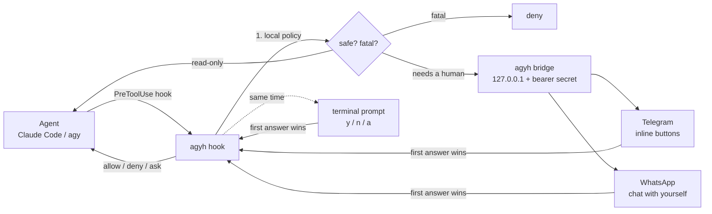

# agyh

[](https://github.com/EliasOlie/agyh/actions/workflows/ci.yml)
[](go.mod)
[](LICENSE)

**Every conversation with your coding agents, in one place: search it, organize it into projects, resume it, and approve what the agent does from your phone.**

`agyh` reads the local history of **Antigravity (`agy`)**, **Claude Code** and **Codex**, indexes it into a single full-text search, and pairs with **Telegram** or **WhatsApp** so a long-running agent can ask *you* before it runs `git push`, even when you are away from the keyboard.

One static Go binary. No server, no account, no telemetry. Your agents' files are only ever read.

```
agyh  all agents · 55 sessions
🔎 rotação credenciais

▸ agy    Credential rotation for the Postgres control plane               3d
         ~/work/pg-cp · #security · …implement [rotação] de [credenciais] with zero downtime…
  claude Refresh-token reuse detection                                    28d
         ~/work/auth · …a token_version bump makes the [rotação] revoke every session…

type to search · ↑/↓ · enter open · ctrl+o resume · ctrl+p project · tab agent · esc quit
```

## Why

Agent CLIs keep history per tool and per folder. After a few weeks you have hundreds of sessions and no way to find "the one where we fixed the Pix webhook", group the five sessions that belong to one feature, or reopen it in the right directory. And when an agent works for 40 minutes, the moment it needs permission is usually the moment you stepped away.

## Features

| | |
|---|---|
| **One index, every agent** | Antigravity, Claude Code and Codex sessions in one list, newest first. |
| **Instant full-text search** | SQLite FTS5 over every message: accent- and case-insensitive (`rotacao` finds *rotação*), prefix matching, highlighted snippets. Ranked by BM25 with **recency tiers** (7d ×4 › 15d ×3 › 30d ×2 › 90d ×1.5), so this week's work comes first. |
| **Incremental indexing** | Only files whose mtime changed are re-parsed: 55 sessions index in ~0.8 s, a re-sync takes ~60 ms. |
| **Projects** | Save sessions from any agent into named projects, with notes. Filter the browser, the CLI and the chat by project. |
| **Resume anywhere** | `agyh resume <id>` reopens the session in its agent **and** its original workspace. |
| **Interactive TUI** | Live search as you type, read whole transcripts, resume, save to project, copy the id (OSC 52). |
| **Encrypted Cloud Vault** | Synchronize sessions & projects across multiple machines via S3-compatible storage (Cloudflare R2, MinIO, AWS S3, any self-hosted S3). Zero-knowledge client-side encryption (AES-256-GCM, Argon2id key with a per-vault random salt). Instant disaster recovery (`agyh sync restore`). |
| **Remote approvals** | Agent hooks send risky commands to Telegram (inline buttons) and/or WhatsApp; the first answer wins, phone or terminal. |
| **Autonomous mode** | One tap allows the rest of a session, while fatal commands stay blocked. |
| **Drive agents from chat** | `/chats`, `/search`, `/show`, `/save`, `/projects`, `/new` (start a headless session in a whitelisted workspace). |
| **WhatsApp onboarding in the terminal** | `agyh connect whatsapp` prints the pairing QR code right in your terminal. |
| **Skills & MCP at a glance** | `agyh skills` and `agyh mcp` show which Agent Skills and MCP servers each agent has, which copies differ, and never print a secret. Read-only. |
| **Scriptable** | Every list command has `--json`. |

## Install

Requires Go 1.26+ (older Go downloads the right toolchain automatically).

```bash
go install github.com/EliasOlie/agyh/cmd/agyh@latest
agyh --version
```

### `agyh: command not found`?

`go install` puts the binary in Go's bin directory: `$(go env GOBIN)`, or `$(go env GOPATH)/bin` (usually `~/go/bin`). Many setups don't have that directory on `PATH`. Pick one fix:

**A. Add Go's bin directory to your PATH** (once; works for every `go install`):

```bash
# bash
echo 'export PATH="$PATH:$(go env GOPATH)/bin"' >> ~/.bashrc && source ~/.bashrc
# zsh
echo 'export PATH="$PATH:$(go env GOPATH)/bin"' >> ~/.zshrc && source ~/.zshrc
# fish
fish_add_path (go env GOPATH)/bin
```

On Windows (PowerShell): `[Environment]::SetEnvironmentVariable("Path", $env:Path + ";$(go env GOPATH)\bin", "User")`, then open a new terminal.

**B. Or install straight into a directory that is already on your PATH:**

```bash
GOBIN="$HOME/.local/bin" go install github.com/EliasOlie/agyh/cmd/agyh@latest
```

If the shell still says *not found* right after installing, run `hash -r` (bash) or `rehash` (zsh), or open a new terminal.

### From source

```bash
git clone https://github.com/EliasOlie/agyh && cd agyh
go build -o agyh ./cmd/agyh   # then move it anywhere on your PATH
```

Pure Go (SQLite via `modernc.org/sqlite`), so `CGO_ENABLED=0` cross-compiles to Linux, macOS and Windows.

## Use it

```bash
agyh                         # interactive browser
agyh pix webhook             # browser, pre-filled with a search
agyh ls -n 20 --agent claude # list
agyh search rotação token    # full-text search (--json for scripts)
agyh show 2ec95bab --last 4  # read a session
agyh resume 2ec9             # reopen it (any unique id prefix works)
agyh resume --last           # reopen the most recent session

agyh project add pagamentos 2ec9 5e6b --note "Pix refunds"
agyh project ls
agyh -p pagamentos           # browser inside one project
```

| Command | What it does |
|---|---|
| `agyh [words]` | Interactive browser (TUI). `-p <project>` scopes it. |
| `agyh ls` / `agyh search <words>` | List or search. Filters: `--agent`, `--project`, `--workspace`, `--all` (sub-agents), `-n`, `--json`. |
| `agyh show <id>` | Metadata and messages. `--last N`, `--json`. |
| `agyh resume [<id> \| --last]` | Exec the agent in the session's workspace. `--print` shows the command instead. |
| `agyh index [--full]` | Sync the index (normally automatic). |
| `agyh project new\|ls\|add\|rm\|show\|rename\|delete` | Manage projects. |
| `agyh sync [status\|push\|pull\|restore\|migrate]` | Synchronize or restore sessions with encrypted cloud vault; `migrate` re-encrypts sessions written by agyh ≤ 0.2 with the vault's own key. |
| `agyh connect telegram\|whatsapp` | Pair a chat channel. |
| `agyh bridge` | Run the daemon that connects hooks and chat. |
| `agyh install-hooks claude\|agy` | Print the hook config to paste into your agent. |
| `agyh skills` | Agent Skills installed in each agent, grouped by name, with differing copies flagged. `--agent`, `--all` (include skills bundled with the agents), `--json`. |
| `agyh skills link <skill>… --to <agents>` | Copy a skill into other agents (e.g. from Antigravity into Claude Code and Codex), or `--all --from kit` after a restore. Opt-in, tracked, never overwrites your files. `--dry-run` previews. |
| `agyh skills unlink <skill>…` / `agyh skills links` | Remove skills agyh installed (only its own, unedited copies) / list them. |
| `agyh skills search <words>` | Find skills and plugins in marketplace catalogs and on GitHub. `--offline`, `--json`. |
| `agyh skills install <github:owner/repo[/path][@rev] \| plugin@catalog> --to <agents>` | Fetch at an exact commit, preview (skills and scripts), confirm, install. `--dry-run`, `--yes`. |
| `agyh mcp apply <server>… --to <agents>` / `agyh mcp remove` / `agyh mcp links` | Copy MCP servers (with their tokens) between agents, converting formats; tracked and reversible. |
| `agyh mcp` | MCP servers configured in each agent, grouped by name. Secrets are never shown. `--agent`, `--json`. |
| `agyh doctor` | Check agents, index, channels and bridge. |

## Remote control



### 1. Pair a channel

**Telegram** (recommended): create a bot with [@BotFather](https://t.me/BotFather), then:

```bash
agyh connect telegram
# Bot token from @BotFather (input hidden): ********
# ✓ Bot @my_agyh_bot found. Now open https://t.me/my_agyh_bot and send /start…
# ✓ Paired with @you (chat 123456789).
```

The bot answers **only that chat id**: anyone else who finds it gets nothing.

**WhatsApp**: links agyh as a device, like WhatsApp Web, and prints the QR code in the terminal:

```bash
agyh connect whatsapp
# On your phone: WhatsApp → Settings → Linked devices → Link a device, then scan:
# █▀▀▀▀▀█ ▄▀ ▄█▀ █▀▀▀▀▀█
# …
```

You then talk to agyh in the **"Message yourself"** chat; every other chat is ignored. This uses [whatsmeow](https://github.com/tulir/whatsmeow), an *unofficial* client. WhatsApp may restrict accounts that use unofficial clients, so prefer a secondary number or use Telegram.

### 2. Install the hooks

```bash
agyh install-hooks claude   # paste into ~/.claude/settings.json
agyh install-hooks agy      # paste into your Antigravity hooks file
```

For Claude Code this adds a `PreToolUse` hook on `Bash` and a `Stop` hook that sends you the agent's final message when it finishes.

### 3. Run the bridge

```bash
agyh bridge     # or as a systemd --user service, see below
```

### How a decision is made

1. **Local policy, in under a millisecond, without the network.**
   - **Fatal** commands are always denied, even in autonomous mode: `sudo`, `rm -rf /`, `git push --force`, `curl … | sh`, writing to `/dev/sd*`, touching `~/.ssh` keys, and so on.
   - **Read-only** commands are allowed: `ls`, `git status`, `rg`, `go vet`, …
   - A command is only read-only if **every** segment of the pipeline or chain is, and it has no redirection (`>`), command substitution (`$(…)`, backticks) or `find -exec`/`-delete`.
2. **Everything else needs a human.** The hook asks the bridge, which sends the request to every connected channel. For Antigravity it also asks in the terminal, with a single keypress. **The first answer wins**, and every other channel is updated ("✅ Allowed via telegram").
3. **⚡ Allow whole session** switches that session to autonomous mode. It persists across bridge restarts and can be turned off with `/auto off <id>`.
4. **No answer before the timeout** (default 120 s), or no bridge running: Claude Code falls back to its own permission prompt (`ask`). Antigravity, which has no "ask", denies.

Add your own patterns in the config: `"policy": {"safe": ["^make\\s+test(\\s|$)"], "fatal": ["\\bterraform\\s+destroy\\b"]}`.

### Chat commands (Bilingual / PT-BR & EN)

| Command / Comando | What it does / O que faz |
|---|---|
| `/chats [n]` · `/sessoes` | Recent sessions from every agent / Sessões recentes |
| `/search <words>` · `/buscar` | Full-text search / Busca em todo o histórico |
| `/show <id>` · `/ver` | Details and messages / Detalhes e mensagens da conversa |
| `/save <id> <project> [note]` · `/salvar` | Save a session into a project / Salvar sessão no projeto |
| `/projects` · `/projetos` | Browse projects / Listar projetos |
| `/new [agent] [@workspace] <prompt>` · `/novo` | Start a headless session / Iniciar tarefa em background |
| `/ws` | Workspaces `/new` may use |
| `/pending` · `/pendentes` | Pending approvals / Aprovações pendentes |
| `/auto [off <id>]` | Autonomous sessions / Sessões em modo autônomo |
| `/sync` · `/sincronizar` | Synchronize with cloud vault / Sincronizar com vault |
| `/start` · `/ajuda` · `/help` | Interactive onboarding & command guide |
| `s <id>` · `y` · `sim` · `allow` | Allow / Permitir comando |
| `n <id>` · `nao` · `rejeitar` · `deny` | Deny / Rejeitar comando |
| `a <id>` · `auto` · `sempre` | Allow whole session (autonomous mode) ⚡ |

## Cloud Vault & Disaster Recovery

Agent history is normally trapped on a single machine and lost whenever you format, switch laptops or work on a remote server. `agyh` includes a client-side encrypted cloud sync engine that turns your history into a persistent, multi-machine AI memory bank:

- **Zero-knowledge encryption**: Every session transcript and project association is compressed with `gzip` and encrypted client-side with **AES-256-GCM**. The key is derived from your passphrase with **Argon2id** (memory-hard: t=3, 64 MiB) and a **random salt unique to each vault**, so a guess computed against one vault is useless against another. The salt and KDF parameters live in a small plaintext `vault.json` (they are not secret), together with a key check that makes a wrong passphrase, or a header someone altered, fail before anything is written; parameters below a safe minimum are refused. The storage provider only ever sees ciphertext. Because anyone who obtains the bucket contents can attempt offline guesses, **use a long, random passphrase** (e.g. a 6+ word diceware phrase or a password-manager-generated secret) and keep it out of your shell history.
- **Your agent kit comes along**: every sync also backs up this machine's **kit**: the skills you installed in each agent (their files, deduplicated by content), the plugins you use (as references, so each agent reinstalls them) and your MCP servers **with their tokens**, all encrypted like everything else. See [Agent kit](#agent-kit).
- **Self-hosted & S3-compatible**: Works with Cloudflare R2, MinIO, AWS S3 or any other S3-compatible store. No SDK dependencies; pure Go implementation over AWS SigV4.
- **Local-first with Archive fallback**: Full-text search and transcript browsing stay local (0 ms latency via SQLite FTS5). If you open a session synced from another machine where local agent files don't exist, `agyh` transparently loads the transcript from its local encrypted archive cache.

```bash
# Check differences between local store and cloud vault
agyh sync status

# Bidirectional sync (uploads local changes, pulls remote sessions)
agyh sync

# Force upload or pull
agyh sync push
agyh sync pull

# Fresh machine or disaster recovery? Reconstruct your entire history from zero,
# plus this machine's kit (skills, plugins, MCP servers):
agyh sync restore
agyh sync restore --machine old-laptop   # reinstalled under a new name? pick the old kit

# Vault created by agyh <= 0.2? Re-encrypt its sessions with the vault's own key:
agyh sync migrate
```

**Upgrading a vault from agyh ≤ 0.2.** Older versions derived every vault's key with PBKDF2 and one salt shared by all agyh users. The first `agyh sync` from this version adds the per-vault header; from then on every new write uses the new format, while older sessions stay readable. `agyh sync status` shows `legacy v1 blobs present` until you run `agyh sync migrate` once (safe to interrupt and re-run). **Upgrade agyh on every machine that shares the vault**: older versions cannot read the new format and will stop with a decryption error instead of overwriting anything. Step-by-step guide, troubleshooting and rollback: [MIGRATION.md](MIGRATION.md).

### Agent kit

A machine's **kit** is its agent environment, saved with every `agyh sync` / `agyh sync push`:

| What | How it is stored |
|---|---|
| Skills you installed (`~/.claude/skills`, Codex's `~/.agents/skills`, …) | Each skill folder, as an encrypted archive named by its content fingerprint: the same skill on five machines is stored once, and only new or changed skills are uploaded. Dependencies a skill installs next to itself (`.venv`, `node_modules`, Playwright browsers…) are left out: a 1.4 GB skill folder backs up as 1.4 MB. |
| Plugins | References only (id, version, where it came from). Plugins are reinstalled through their agent, never copied. Skills shipped inside plugins come back with the plugin. |
| MCP servers | Every server entry exactly as each agent stores it, **tokens included**, encrypted with the vault key. |

Snapshots are **per machine** (named by `sync.machine`, else the hostname): restoring brings back exactly the environment that machine had. `agyh sync status` lists every machine's snapshot.

`agyh sync restore` writes the kit into agyh's own data directory, **never into an agent's configuration**:

```
~/.local/share/agyh/kit/<machine>/
  claude/skills/<name>/     each skill, verified against its fingerprint
  claude/mcp.json           MCP servers with their secrets (mode 0600)
  agy/…  codex/…
  plugins.json              plugins to reinstall
  kit.json                  the snapshot, without secrets
```

Archives are checked before anything is written (only regular files with clean relative paths, size limits, and the restored folder must match the recorded fingerprint). To put the restored skills back into your agents, run `agyh skills link --all --from kit` (see [Sharing skills between agents](#sharing-skills-between-agents)). To sync conversations only, set `"kit": false` under `"sync"`.

## Security model

agyh can approve shell commands, so it is built to fail closed:

- The bridge listens on **loopback only**; it refuses to start on any other address. Every call needs a 256-bit bearer secret, compared in constant time.
- `~/.config/agyh/config.json` and the WhatsApp session store are written with mode `0600`.
- Chat input is never passed to a shell. `/new` runs the configured runner with the prompt as **one argv element**, and only inside workspaces listed in the config.
- Only the paired Telegram chat id, or your own WhatsApp "Message yourself" chat, can send commands or press buttons.
- The bridge re-checks the policy itself, so even a misconfigured hook or autonomous session cannot get a fatal command approved.
- The bot token never appears in errors or logs. Network errors from the Bot API are stripped of the URL.
- Agent data is opened **read-only** (`mode=ro` for SQLite). agyh writes its own files (the index, the kit under `~/.local/share/agyh/kit/`) and, **only if you enable `"manage_agents": true`**, skill folders and MCP servers inside agents' configuration (`agyh skills link/install`, `agyh mcp apply`, and bridge propagation you approve on chat). It never touches a skill folder or MCP server it did not create, nor one it created that you edited since; every change is recorded in `~/.local/share/agyh/links.json` and can be undone (`agyh skills unlink`, `agyh mcp remove`). Claude Code's config is only changed through its own CLI.
- The vault holds your **MCP tokens** (encrypted): whoever has the bucket *and* your passphrase has them too. Use a strong passphrase; `"kit": false` keeps them out of the vault.

## Configuration

`~/.config/agyh/config.json` (created by `connect`):

```json
{
  "bridge": { "addr": "127.0.0.1:9123", "secret": "generated" },
  "telegram": { "token": "from @BotFather", "chat_id": 123456789 },
  "whatsapp": { "enabled": true, "jid": "5581999999999@s.whatsapp.net" },
  "approval_timeout_sec": 120,
  "runners": { "claude": ["claude", "-p", "{prompt}"] },
  "workspaces": ["/home/you/work/api", "/home/you/work/pdv"],
  "manage_agents": false,
  "auto_propagate": false,
  "catalogs": ["github:owner/marketplace-repo"],
  "policy": { "safe": [], "fatal": [] },
  "sync": {
    "enabled": true,
    "endpoint": "https://s3.example.com",
    "bucket": "agyh-vault",
    "region": "us-east-1",
    "access_key": "AKIA...",
    "secret_key": "...",
    "passphrase": "your-master-encryption-key",
    "prefix": "vault",
    "machine": "work-laptop",
    "kit": true
  }
}
```

| Variable | Default |
|---|---|
| `AGYH_DB` | `$XDG_DATA_HOME/agyh/index.db` (`~/.local/share/agyh/index.db`) |
| `AGYH_CONFIG_DIR` | `$XDG_CONFIG_HOME/agyh` |
| `AGYH_AGY_DIR` | `~/.gemini/antigravity-cli` |
| `AGYH_CLAUDE_DIR` | `$CLAUDE_CONFIG_DIR/projects` or `~/.claude/projects` |
| `AGYH_CODEX_DIR` | `$CODEX_HOME/sessions` or `~/.codex/sessions` |
| `AGYH_SYNC_ENDPOINT` | Custom S3 endpoint URL (e.g. `https://<account>.r2.cloudflarestorage.com`) |
| `AGYH_SYNC_BUCKET` | S3 bucket name |
| `AGYH_SYNC_PASSPHRASE` | Passphrase for client-side AES-256-GCM zero-knowledge encryption |
| `AGYH_SYNC_MACHINE` | Name of this machine's kit snapshot (default: hostname) |

Run the bridge as a user service:

```ini
# ~/.config/systemd/user/agyh-bridge.service
[Unit]
Description=agyh bridge
After=network-online.target

[Service]
ExecStart=%h/go/bin/agyh bridge
Restart=on-failure

[Install]
WantedBy=default.target
```

```bash
systemctl --user enable --now agyh-bridge
```

## Where the data comes from

| Agent | Sessions | Messages |
|---|---|---|
| Antigravity | `conversation_summaries.db` (read-only) | `brain/<id>/.system_generated/logs/transcript.jsonl`; user text from `<USER_REQUEST>` |
| Claude Code | `projects/<encoded-cwd>/<id>.jsonl` | `user` / `assistant` text blocks; tool calls, sidechains, meta and slash-command noise dropped; `custom-title` honored |
| Codex | `sessions/YYYY/MM/DD/rollout-*.jsonl` | `response_item` messages; environment and instruction preambles dropped |

Adding an agent means implementing one interface (`internal/source`): `Refs` (list cheaply), `Load` (parse one session), `Resume` (argv to reopen).

### Skills and MCP servers

`agyh skills` and `agyh mcp` only read these files. Writing skills into agents is a separate, opt-in command: see below.

| Agent | Skills | MCP servers |
|---|---|---|
| Claude Code | `~/.claude/skills/<name>/SKILL.md` (incl. `synced/` from claude.ai and plugin folders), skills of installed plugins (`plugins/installed_plugins.json`; enabled per `enabledPlugins` in `settings.json`, else the plugin's `defaultEnabled`). The marketplace catalog in `plugins/marketplaces/` is not "installed" and is ignored. Honors `CLAUDE_CONFIG_DIR` and `CLAUDE_CODE_PLUGIN_CACHE_DIR`. | `~/.claude.json`: `mcpServers` (user scope) and `projects[<path>].mcpServers` (local scope) |
| Antigravity | `~/.gemini/config/plugins/<plugin>/skills/`, and with `--all` the skills bundled in `~/.gemini/antigravity-cli/builtin/skills/` | `~/.gemini/config/mcp_config.json` |
| Codex ⚠️ | `~/.agents/skills/`, `$CODEX_HOME/skills/` (older location), `/etc/codex/skills/`; `[[skills.config]] enabled = false` in `config.toml` | `[mcp_servers.<name>]` in `$CODEX_HOME/config.toml` |

#### Sharing skills between agents

Install a skill once, in any agent, and make it available to the others:

```bash
agyh skills link ponytail --to claude,codex --dry-run   # preview
agyh skills link ponytail --to claude,codex             # copy it
agyh skills link --all --from kit                       # after `agyh sync restore`: every skill back where it was
agyh skills links                                       # what agyh installed, and whether you edited it since
agyh skills unlink ponytail --agent codex               # undo
```

This is the only place agyh writes into an agent's files, so it is off until you add `"manage_agents": true` to `~/.config/agyh/config.json`, and it follows strict rules:

- Skills are **copied** (not symlinked) into the agent's user skills folder: `~/.claude/skills/` for Claude Code, `~/.agents/skills/` for Codex. The copy is verified against the source's fingerprint.
- A folder that **agyh did not create is never touched**, even if it has the same name; an identical one is reported and left alone.
- A copy **you edited** after agyh installed it is yours: it is never updated or removed.
- If a folder changes between planning and writing, the write is refused.
- When one name has different versions in different agents, agyh asks you to pick one with `--from`.
- Antigravity can be a source, not a target: it has no documented folder for user skills (PRs welcome).

**Automatic propagation, with your approval.** With `"auto_propagate": true` (and `manage_agents`), the running `agyh bridge` notices a skill that appears or changes in one agent and asks on Telegram/WhatsApp before installing it into the agents that lack it: ✅ installs, ❌ never asks again for that version, ⚡ approves future propagations (until `/auto off skills-propagation`). Skills that already existed when you enabled it are only recorded, never offered all at once; use `agyh skills link --all` for those. Unanswered prompts are asked again after a day.

#### MCP servers across agents

```bash
agyh mcp apply github --to agy,codex --dry-run   # preview
agyh mcp apply github --to agy,codex             # same server, tokens included, in each agent's format
agyh mcp apply --all --from kit                  # after `agyh sync restore`
agyh mcp links                                   # what agyh added
agyh mcp remove github --agent codex             # undo
```

Same rules as skills (opt-in, tracked, never replaces a server you configured or edited). How each agent is written, user scope:

| Agent | How |
|---|---|
| Claude Code | Through its own CLI (`claude mcp add-json` / `claude mcp remove`). `~/.claude.json` is rewritten by Claude Code all the time and is never edited directly. |
| Antigravity | `mcp_config.json`, edited in place: other servers and keys keep their content, and the previous file is saved as `mcp_config.json.agyh-backup`. |
| Codex ⚠️ | A block between `# agyh:begin` / `# agyh:end` markers appended to `config.toml`, so your comments and layout are kept; `agyh mcp remove` deletes exactly that block. Untested against a real Codex install. |

Settings that have no equivalent in the target agent (Codex's tool allow-lists or timeouts, for example) are listed when you apply, never silently dropped. `sse` servers land as `http` in agents without `sse`.

#### Finding new skills

```bash
agyh skills search pdf                                       # marketplace catalogs + GitHub
agyh skills install github:anthropics/skills/skills/pdf --to claude,codex --dry-run
agyh skills install some-plugin@some-marketplace --to codex
```

`search` looks in the plugin marketplaces Claude Code has downloaded, in any catalog listed under `"catalogs"` (a `github:owner/repo` publishing `.claude-plugin/marketplace.json`, or an https URL), and in GitHub repositories tagged `agent-skills` or `claude-skills` (set `GITHUB_TOKEN` for higher rate limits; it is sent to GitHub only, never printed).

`install` pins what it fetches to an **exact commit**, shows a preview (each skill, its description, and every script your agents could run, with a link to review that commit), asks before installing (`--yes` skips the question, `--dry-run` stops after the preview) and installs through the same ledger as `agyh skills link`. Downloads are treated as untrusted: only regular files with clean relative paths are extracted, within size limits. Plugins that are not on GitHub are listed with a hint to install them with their agent.

⚠️ **Codex support follows [OpenAI's public docs](https://learn.chatgpt.com/docs/build-skills) and has not been tested against a real Codex install.** If it misreads yours, please [open an issue](https://github.com/EliasOlie/agyh/issues/new/choose) or, even better, a PR with a fixture in `internal/agentkit/agentkit_test.go`.

A skill's identity is a fingerprint of its folder (paths, executable bits and contents), so the same skill installed in two agents is recognized as one, and edited copies are flagged. Dependencies and caches a skill installs next to itself (`.venv`, `node_modules`, `ms-playwright`, `__pycache__`, VCS folders…) are not part of it. For MCP servers, only non-secret facts are kept: the command name (never its arguments), the URL's scheme and host (never its path or query) and the names of environment variables (never their values); header values are never read out.

## Design notes

- **Read cheaply, parse lazily.** `Refs` only stats files. The indexer compares mtimes with the index and parses the changed sessions in a bounded worker pool, writing in batched transactions from a single goroutine (SQLite has one writer).
- **Search input can't inject FTS5 syntax.** Every word is quoted and turned into a prefix term, so `NEAR(`, `OR`, `*` or a stray `"` are just text.
- **Robust JSONL.** Agents append while they run, so partial last lines and multi-megabyte tool outputs are expected. Lines are read with a growing buffer and invalid ones skipped.
- **One decision, many channels.** An approval is resolved exactly once (`sync.Once`); every channel learns the outcome and edits its message, so you never tap a stale button.
- **No SDKs where a few lines do.** The Telegram client is ~100 lines over the Bot API, with an `httptest` fake in the tests.

## Development

```bash
go test -race ./...
go vet ./...
```

The tests cover parsing for each agent's format, incremental sync, search (accents, prefixes, injection), projects, the policy table, the hook I/O formats, and the full approval flow: phone vs. terminal races, timeouts, autonomous mode, fatal-command override. They also cover the Telegram channel against a fake Bot API (strangers ignored, token never leaked), `/new` argv safety and the TUI model.

## Origin

agyh started as a 680-line bash script I used daily to search my Antigravity history, plus a Python Telegram bridge for approving commands from my phone. v2 is a rewrite in Go: multi-agent, real full-text search, projects, WhatsApp, and a security model I'd be comfortable publishing.

## License

[MIT](LICENSE)
